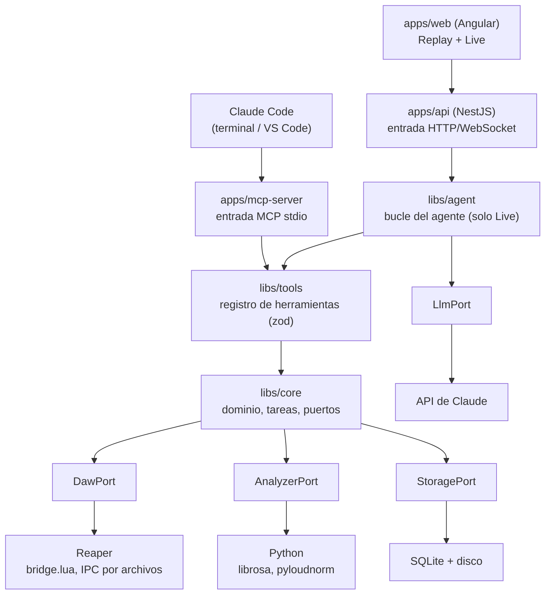
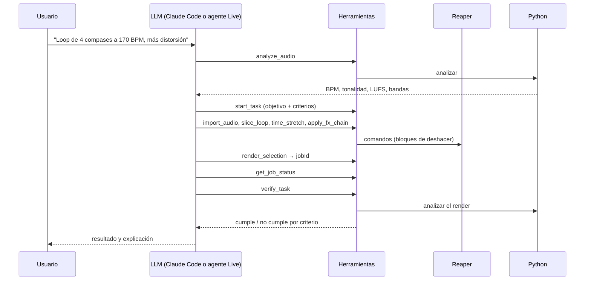
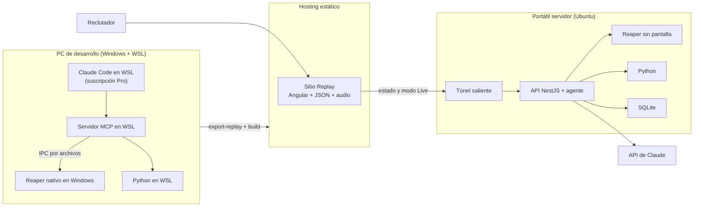

# Reaper Copilot

Documento maestro del proyecto (v2.8, 16-nov-2026). Es la fuente de verdad: sustituye a los borradores anteriores.

Lo leen tres públicos:

- **El autor**, como referencia de diseño.
- **Un reclutador o evaluador**, para entender qué es y cómo está hecho (secciones 1 a 4).
- **Claude Code**, como prompt inicial del planificador (leer primero la sección 2).

---

## 1. Resumen

Reaper Copilot es un copiloto de IA para el DAW [Reaper](https://www.reaper.fm/). El usuario describe en lenguaje natural lo que quiere hacer con un audio y el sistema lo analiza, lo ejecuta en Reaper y **verifica el resultado con medidas objetivas**.

Ejemplo de petición: *"De esta canción saca un loop de 4 compases, súbelo a 170 BPM y hazlo sonar más distorsionado."*

- **Género objetivo:** techno hardcore, uptempo y hardstyle (150-200 BPM o más).
- **Naturaleza:** proyecto didáctico y de portfolio, de un solo autor, diseñado para crecer sin deuda técnica.
- **Idea central:** el valor no está en el chat, sino en la capa de herramientas: análisis de audio, control seguro de Reaper, presets de efectos y verificación medible. El LLM nunca oye audio; razona sobre números.

El producto se entrega en **tres bloques** sobre un mismo núcleo:

| Bloque | Qué es | Quién lo usa | Dónde corre | Coste de IA |
|---|---|---|---|---|
| **MCP** | Servidor MCP con las herramientas | El autor, desde Claude Code; otros desarrolladores | PC de desarrollo (WSL) | Suscripción del usuario |
| **Replay** | Web que reproduce ejecuciones grabadas, con audio antes y después | Reclutadores | Hosting estático | Cero |
| **Live** | Agente en directo, restringido | Reclutadores con código de invitación | Portátil servidor | API de Claude, con tope |

---

## 2. Instrucciones para Claude Code (planificador)

1. Este documento es de **diseño**. Antes de implementar, produce un plan por fases a partir de la sección 13, con hitos verificables y criterios de salida medibles.
2. **Empieza por los spikes de la fase 0.** No des por hecho que algo funciona hasta comprobarlo. Lo marcado como *(a comprobar)* no está verificado.
3. Respeta las **reglas no negociables** de la sección 2.1.
4. Si algo es ambiguo o falta, añádelo a las preguntas abiertas (sección 15) y pregunta; no decidas en silencio.
5. Señala dependencias entre tareas, riesgos y qué se puede paralelizar.
6. Trabaja en incrementos pequeños, cada uno con sus pruebas. El autor está aprendiendo TypeScript, Angular y NestJS: prioriza código claro y explica las decisiones no obvias.
7. Código, identificadores y commits en inglés. README en inglés y español *(propuesta, pendiente de confirmar)*.

### 2.1 Reglas no negociables

- **Núcleo sin dependencias externas.** `libs/core` no importa NestJS, Angular, Reaper, Python ni SDKs de terceros. Única excepción: `zod`, para definir cada contrato una sola vez (esquema y tipo salen del mismo código).
- **Herramientas definidas una sola vez** en `libs/tools`, y reutilizadas por el servidor MCP y por el agente del modo Live.
- **Solo herramientas MCP estándar (tools).** No depender de prompts, elicitación, tareas ni sampling del protocolo.
- **Conjunto cerrado de comandos hacia Reaper.** No existe ninguna herramienta que ejecute código arbitrario (Lua, shell).
- **No destructivo.** Los archivos originales no se modifican. Cada comando que cambia el proyecto va en un bloque de deshacer de Reaper.
- **Rutas restringidas al workspace.** Toda ruta recibida se valida.
- **La verificación es código**, no opinión del LLM.
- **El LLM recibe resúmenes compactos en JSON**, nunca audio ni arrays de muestras.
- **Contratos tipados con zod** en cada frontera (Python, Reaper, LLM, HTTP).
- **Sin API de Claude en las fases 0 a 3.** La clave de API solo existe en el servidor del modo Live, en su `.env`. Nunca exportar `ANTHROPIC_API_KEY` en el entorno global: haría que Claude Code facturase por API en vez de usar la suscripción.
- **Evitar dependencias con licencia AGPL** (por ejemplo Essentia).

---

## 3. Usuarios y escenarios

1. **El autor.** Usa el servidor MCP desde Claude Code en WSL (terminal y extensión de VS Code) con su suscripción Pro. Quiere aprender producción y producir sus propios temas.
2. **Reclutadores y evaluadores.** Tienen pocos minutos, probablemente ningún cliente MCP y ninguna suscripción de IA. Necesitan verlo funcionar desde una URL, sin instalar nada.
3. **Desarrolladores.** Llegan por GitHub y quieren conectar el servidor a su propio cliente MCP.

---

## 4. Los tres bloques

### 4.1 Bloque MCP (producto central)

- Servidor MCP por **stdio** que expone las herramientas de la sección 7.
- Cada usuario aporta su cliente y su suscripción: el proyecto no gestiona claves ni costes.
- **Compatibilidad probada:** Claude Code en terminal y en la extensión de VS Code, ambos en WSL. Otros clientes (Claude Desktop, Cursor, etc.) deberían funcionar al usar solo herramientas estándar, pero no están probados y no se prometen.
- **Modos**, por variable de entorno `MODE`:
  - `mentor`: solo se exponen las herramientas de lectura. El LLM analiza y explica, no toca nada.
  - `agent`: se exponen todas.
  - Desde F2a, el `.mcp.json` del repositorio usa `mentor`; el autor registra `agent` en su ámbito local (`claude mcp add --scope local`). Sin reglas `ask` en `.claude/settings.json`: la protección vive en el servidor (sección 12.1).
- Instalación para terceros: `claude mcp add` y un `.mcp.json` en el repositorio *(a comprobar)*.

### 4.2 Bloque Replay (portfolio, siempre disponible)

- Aplicación Angular compilada como **sitio estático**.
- Reproduce **ejecuciones grabadas**: la petición, los pasos (llamadas a herramientas), los criterios y su resultado, con reproductores de audio antes y después, forma de onda y espectro.
- No es un vídeo: es una página interactiva alimentada por archivos JSON y de audio exportados desde las trazas reales (sección 9). Un vídeo corto en el README la complementa.
- Sin backend, sin API, sin Reaper. Coste cero.
- Muestra un indicador "demo en vivo disponible / no disponible" consultando el estado del servidor Live.
- **Audio público:** solo material propio o con licencia que permita publicarlo. No usar fragmentos de canciones comerciales en la demo.

### 4.3 Bloque Live (portfolio, restringido)

- Un agente propio (bucle con la API de Claude) que usa las mismas herramientas sobre un Reaper real en el portátil servidor.
- Restricciones:
  - **Código de invitación** que entrega el autor.
  - **Solo muestras preinstaladas.** Sin subida de archivos.
  - **Una ejecución a la vez** (cola), porque Reaper es de una sola instancia.
  - Límite de iteraciones, de tiempo y de peticiones por visitante.
  - **Tope de gasto mensual** en la consola de Anthropic y modelo económico.
- Si el portátil está apagado, el portfolio sigue funcionando con el Replay.

---

## 5. Alcance

### 5.1 MVP: "el loop a 170"

1. Analizar un archivo: BPM (con alternativas mitad y doble), tonalidad, LUFS, bandas de frecuencia y factor de cresta.
2. Importarlo a Reaper y cortar un loop por compases.
3. Time-stretch al BPM objetivo.
4. Aplicar una cadena de efectos desde presets (distorsión, EQ, limitador) con plugins de serie.
5. Renderizar, reanalizar y comparar con los criterios (verificación).
6. Modos mentor y agente.

### 5.2 Fuera del MVP

Separación de stems, composición MIDI, mezcla y master completos, RAG, varios usuarios simultáneos, LLM local, plugins de terceros.

### 5.3 Después

Comparación con pista de referencia, patrones MIDI de hardstyle, búsqueda en la documentación de Reaper (sección 5.4), recetas por género sobre la misma infraestructura, experimento con un LLM local (Ollama), soporte probado de otros clientes MCP.

### 5.4 Ampliación prevista: búsqueda en la documentación de Reaper (RAG)

Objetivo: que el usuario pregunte cómo se hace algo en Reaper y reciba una respuesta apoyada en la documentación, con cita. Refuerza el modo mentor y ayuda al propio desarrollo (referencia de ReaScript para escribir `bridge.lua`).

- **Solo se construye la recuperación.** La respuesta la genera el LLM del cliente (Claude Code) o el agente Live. No añade coste de API.
- **Herramienta nueva de lectura:** `search_reaper_docs(query, topK)` devuelve fragmentos con su fuente (documento, sección, página).
- **Puerto nuevo:** `KnowledgePort`, con un adaptador propio. No modifica el resto de la arquitectura.
- **Ingesta:** script que trocea la guía de usuario de Reaper y la referencia de ReaScript en fragmentos con metadatos.
- **Índice:** embeddings con un modelo pequeño ejecutado en local (CPU) y almacenamiento en SQLite con extensión vectorial *(modelo y extensión a comprobar)*. Búsqueda híbrida: palabras clave (FTS de SQLite) más vectorial.
- **Idioma:** la documentación está en inglés; el LLM formula la consulta en inglés y responde en el idioma del usuario.
- **Evaluación:** conjunto de preguntas con el fragmento esperado; medir si aparece entre los primeros resultados, comparando solo palabras clave, solo vectores e híbrido.
- **Derechos:** la documentación tiene copyright. El repositorio incluye solo el script de ingesta; cada usuario indexa su propia copia. Ni el texto ni el índice se publican en el repositorio ni en la demo pública sin revisar antes la licencia.
- **Fuera del MVP:** fase 5, o miniproyecto en paralelo que no bloquea las fases 1 a 4.

---

## 6. Arquitectura

### 6.1 Principios

Arquitectura hexagonal (puertos y adaptadores). El núcleo define **puertos** (interfaces) y todo lo externo se conecta con **adaptadores**. Hay dos **entradas** al mismo núcleo: el servidor MCP y la API del modo Live. Cambiar de DAW, de LLM o de almacenamiento es escribir un adaptador nuevo.

### 6.2 Capas



### 6.3 Estructura del monorepo (Nx)

```
reaper-copilot/
├─ apps/
│  ├─ mcp-server/      entrada MCP (stdio). Bloque MCP
│  ├─ api/             NestJS: agente Live, cola, salud, trazas
│  └─ web/             Angular: Replay (estático) y Live
├─ libs/
│  ├─ core/            dominio puro: tipos, puertos, Task, errores
│  ├─ tools/           definiciones (zod) y handlers de herramientas
│  ├─ agent/           bucle del agente para Live
│  ├─ adapters/
│  │  ├─ reaper/         DawPort sobre IPC por archivos
│  │  ├─ analysis-py/    AnalyzerPort (proceso hijo de Python)
│  │  ├─ llm-anthropic/  LlmPort
│  │  └─ storage-sqlite/ StoragePort
│  └─ testing/         FakeDaw, FakeAnalyzer, FakeLlm
├─ python/analysis/    paquete Python + CLI + tests
├─ reaper/
│  ├─ bridge/          bridge.lua
│  └─ presets/         cadenas de FX en JSON
├─ evals/              peticiones doradas y criterios
├─ deploy/             systemd, túnel, scripts del servidor
└─ docs/
```

**Regla de dependencias:** `core` ← `tools` ← `agent` ← `apps`. Los adaptadores solo dependen de `core`. `testing` solo depende de `core` y lo usan `tools`, `agent` y `apps` (solo en pruebas). Las `apps` cablean puertos y adaptadores.

### 6.4 Puertos

```ts
interface DawPort {
  getProjectState(): Promise<ProjectState>;
  setTempo(bpm: number): Promise<void>;
  importAudio(path: AssetPath): Promise<ItemRef>;
  sliceByBars(item: ItemRef, startBar: number, bars: number): Promise<ItemRef>;
  stretchToTempo(item: ItemRef, targetBpm: number): Promise<ItemRef>;
  applyFxChain(track: TrackRef, preset: PresetId, params?: Record<string, number>): Promise<void>;
  render(opts: RenderOpts): Promise<JobId>;
  undo(steps: number): Promise<void>;
}

interface AnalyzerPort {
  analyze(path: AssetPath, options?: { targetBpm?: number }): Promise<AudioFeatures>;
}

// F1b. Tareas, trabajos y assets se añadirán en las fases siguientes.
interface AnalysisCacheKey { sha256: string; targetBpm: number | null; revision: string }
interface ToolCallTrace {
  sessionId: string; step: number; tool: string;
  args: unknown; ok: boolean; result: unknown | null; errorCode: string | null;
  durationMs: number; startedAt: string; // ISO 8601
  cacheHits: number;
}
interface StoragePort {
  getCachedAnalysis(key: AnalysisCacheKey): Promise<AudioFeatures | null>;
  putCachedAnalysis(key: AnalysisCacheKey, features: AudioFeatures): Promise<void>;
  recordToolCall(trace: ToolCallTrace): Promise<void>;
  listToolCalls(options?: { limit?: number }): Promise<ToolCallTrace[]>; // más recientes primero
}

interface LlmPort { runTurn(input: TurnInput): AsyncIterable<LlmEvent>; } // solo Live
```

Son un punto de partida; el planificador puede ajustarlos. `AnalyzerPort` no tiene `compare`: la comparación es una función pura de `core` (`compareFeatures`) sobre dos `AudioFeatures`, así reutiliza la caché y no vuelve a cargar librosa.

---

## 7. Herramientas

Conjunto cerrado. Pocas, de alto nivel y con descripciones claras.

| Herramienta | Riesgo | Descripción |
|---|---|---|
| `analyze_audio` | lectura | Analiza un archivo y devuelve JSON compacto. Caché por sha256 de los bytes del archivo, el `targetBpm` y la revisión del método de análisis (sección 9.3) |
| `compare_audio` | lectura | Diferencias entre dos análisis. Entrada `{ a: { path, targetBpm? }, b: { path, targetBpm? } }`. Salida `{ a, b, metrics, tempo, key }`: `a` y `b` con la ruta del cliente y el sha256; `metrics` con las 11 métricas de la sección 9.2, cada una con `a`, `b` y `delta = b − a` (2 decimales); `tempo` con `confidence` y `target` de cada lado; `key` con `a`, `b` y `same`. Usa la caché |
| `get_project_state` | lectura | Pistas, items y tempo del proyecto |
| `list_presets` | lectura | Presets de FX con sus parámetros y rangos |
| `get_job_status` | lectura | Estado de un render o análisis largo |
| `verify_task` | lectura | Mide el render y devuelve el resultado por criterio (sección 9.2). No acepta criterios |
| `start_task` | modifica (ligero) | Registra la petición literal, el audio de origen, el objetivo y los criterios (sección 9.2) |
| `import_audio` | modifica | Importa desde el workspace; el original no se toca |
| `set_tempo` | modifica | Cambia el tempo del proyecto |
| `slice_loop` | modifica | Corta un loop por compases |
| `time_stretch` | modifica | Estira al BPM objetivo |
| `apply_fx_chain` | modifica | Aplica un preset con parámetros dentro de rango |
| `render_selection` | modifica | Asíncrono: devuelve `jobId` |
| `undo_last` | modifica | Deshace el último bloque |

En modo `mentor` solo se exponen las de lectura.

**Presets de FX como datos.** Las cadenas (por ejemplo `distortion_hard`, `kick_punch`) son JSON versionado en `reaper/presets/`, con plugins de serie de Reaper (ReaEQ, ReaComp, ReaPitch, ReaSamplOmatic5000, efectos JS de distorsión y limitador), parámetros y rangos permitidos.

---

## 8. Contratos externos

### 8.1 TypeScript con Python

- CLI: `python -m analysis analyze [--target-bpm N] -- <ruta>`. No hay subcomando `compare`: la comparación se calcula en TypeScript (sección 6.4). El `--` evita que un nombre de archivo se lea como opción.
- Salida JSON por stdout; errores por stderr con un código legible al principio (`file_not_found: …`) y código de salida distinto de cero: 2 `file_not_found` (inexistente o ilegible), 3 `unsupported_format` (formato no admitido, audio de menos de 0,5 s o fallo al decodificar), 1 `analysis_failed` (cualquier otro error, incluidos los de argumentos).

```json
{
  "schemaVersion": 2,
  "file": { "sha256": "…", "durationSec": 12.4, "sampleRate": 44100, "channels": 2 },
  "tempo": { "bpm": 128.0, "confidence": 0.82, "alternatives": [64.0, 256.0],
             "target": { "bpm": 130, "deviationBpm": -2.0, "matches": false } },
  "key": { "tonic": "A", "mode": "minor", "confidence": 0.61 },
  "loudness": { "integratedLufs": -9.3, "peakDb": -0.4 },
  "bands": { "sub": -18.2, "bass": -12.1, "lowMid": -14.0, "mid": -15.3, "highMid": -17.8, "high": -22.5 },
  "dynamics": { "crestFactorDb": 7.9 }
}
```

- El esquema vive en zod (`AudioFeaturesSchema`, en `libs/core`) y es estricto: no admite campos extra. Hay tests de contrato contra la salida real de Python (`test:contract`).
- **Tempo.** `tempo.target` es `null` sin tempo objetivo; con él, `{ bpm, deviationBpm, matches }`, donde `deviationBpm = bpm − target.bpm` (con el `bpm` ya redondeado, 2 decimales) y `matches = |deviationBpm| ≤ 1`. `schemaVersion` es 2 desde F1b.
- **Archivo.** `sha256` son los bytes del archivo, en hexadecimal minúscula. `durationSec`, `sampleRate` y `channels` son los del archivo original y positivos.
- **Tonalidad.** `tonic` es una de `C, C#, D, D#, E, F, F#, G, G#, A, A#, B`; `mode`, `major` o `minor`; las confianzas van de 0 a 1. Se obtiene del croma CQT y los perfiles de Krumhansl-Kessler. En silencio sale `C major` con confianza 0.
- **Sonoridad y dinámica.** `integratedLufs` con pyloudnorm. `peakDb` es el pico de muestra del audio decodificado, entre todos los canales. No es pico real (*true peak*) y en formatos con pérdida puede superar 0 dBFS (medido: los MP3 de prueba, masterizados a ~−4 LUFS, tienen entre el 1 y el 3 % de muestras por encima de 0 dBFS y picos de hasta +5,45 dB). `crestFactorDb` es el pico menos el RMS global, con mínimo 0.
- **Bandas** (Hz, intervalos [bajo, alto)): `sub` 20-60, `bass` 60-250, `lowMid` 250-500, `mid` 500-2000, `highMid` 2000-6000, `high` 6000-20000. Se calculan sobre la mezcla mono con Welch, en dB relativos a un seno de fondo de escala: un seno a −12 dBFS da −12 en su banda.
- **Números finitos.** Lo que saldría como menos infinito (silencio) se limita a −120. Redondeo: dB y BPM a 2 decimales, confianzas a 3.
- **Errores de dominio** (`CopilotError`, lista cerrada de códigos): `path_outside_workspace`, `file_not_found`, `unsupported_format`, `analysis_failed`, `analysis_timeout`, `invalid_analysis_output`. El servidor MCP los devuelve con `isError: true` y el código al principio del mensaje. Hay además dos códigos de protocolo, fuera de la lista de dominio: `internal_error` (error inesperado o salida de una herramienta fuera de su esquema; antes esto último daba `invalid_analysis_output`), con el mensaje `internal_error: the tool failed unexpectedly`, e `invalid_input` (entrada que no cumple el esquema; mensaje fijo). El detalle de ambos solo va al registro (stderr).
- **Adaptador** (`libs/adapters/analysis-py`): proceso hijo sin shell, tiempo límite de 120 s por defecto, stdout de 1 MB como máximo y stderr truncado a 8 KiB. La salida se valida con el esquema antes de devolverla.
- **Rutas.** Relativas al workspace (`<repositorio>/workspace` por defecto, ignorado por git y que hay que crear; se cambia con `COPILOT_WORKSPACE`) o absolutas dentro de él. Se comprueba de forma léxica y otra vez tras `realpath`; extensiones admitidas: `.wav .flac .mp3 .aiff .ogg`.
- **Servidor MCP** (`apps/mcp-server`, stdio). Variables: `MODE` (`mentor` por defecto; un valor inválido hace fallar el arranque), `COPILOT_WORKSPACE` y `COPILOT_PYTHON` (por defecto `python/analysis/.venv/bin/python`). El `.mcp.json` de la raíz lo registra con `MODE=agent`. `pnpm mcp:call <herramienta> '<json>'` llama a una herramienta desde la terminal. `COPILOT_DATA_DIR` fija dónde se guarda la base SQLite (sección 9.3). `pnpm mcp:traces [n]` imprime las últimas `n` trazas. Medido: `analyze_audio` tarda 1,7 s la primera vez (casi todo arranque de librosa) y 0,2 s desde la caché; `compare_audio`, 7,8 s frente a 0,25 s.
- **Método de tempo.** `librosa.feature.tempo` no se usa como medida final: sin pista cae a la mitad entre 180 y 210 BPM, y su resolución no permite afinar a ±1 BPM. El tempo se obtiene con una búsqueda fina (pasos de 0,05 BPM) sobre la autocorrelación de la envolvente de ataques, calculada con librosa y `hop_length=64`, puntuando cada candidato a 1, 2, 4 y 8 tiempos.
- **Rango de búsqueda.** Con tempo objetivo `t`, se busca en una octava centrada en él, `[t/√2, t·√2]`: el objetivo elige la octava (el tempo, su mitad o su doble) pero no arrastra la medida. Sin objetivo, el rango del género (140-230 BPM). En ambos casos se devuelven las alternativas mitad y doble. Motivo: con ±4 % alrededor del objetivo, un tema a 160 con objetivo 190 salía a 182,9 (descubierto al usar F1a); `tempo.target.matches` dice si la medida coincide con el objetivo.
- **`tempo.confidence` es la puntuación de esa búsqueda** (0 a 1). Por debajo de 0,10 el tempo no se considera medible y el criterio de BPM devuelve `unmeasured` (sección 9.2). Umbral provisional.
- Fragmentos de 4 compases no son del todo fiables: por eso la comprobación principal del tempo es la duración (sección 9.2).
- Origen: `specs/spikes/librosa-bpm-alto.md`.

### 8.2 TypeScript con Reaper

- Un script `bridge.lua` corre dentro de Reaper y sondea con `reaper.defer`.
- IPC por archivos en el workspace: `inbox/` (peticiones) y `outbox/` (respuestas), con escritura atómica (archivo temporal y renombrado).
- Petición: `{ id, method, params, schemaVersion }`. Respuesta: `{ id, ok, result | error }`.
- Lista cerrada de métodos, validados a ambos lados. Cada método mutante se envuelve en un bloque de deshacer.
- Un solo cliente y una sola instancia de Reaper a la vez: el archivo de bloqueo identifica a ambos. Los nombres de archivo en `inbox/` y `outbox/` son únicos, porque en Windows el renombrado no sobrescribe.
- **Dónde corre Reaper.** En desarrollo, Reaper es nativo de Windows y el resto (servidor MCP, Node, Python) corre en WSL; la interfaz de Reaper por WSLg no es usable. En el servidor, Reaper para Linux comparte sistema de archivos con el backend.
- **El workspace y el IPC viven en el sistema de archivos de Linux.** En desarrollo, Reaper los alcanza por `\\wsl.localhost\<distribución>\...`.
- **Traducción de rutas en el adaptador de Reaper**, en los dos sentidos: de Linux a UNC en lo que envía y de UNC a Linux en lo que recibe. Es configuración del adaptador; en el servidor es la identidad. El núcleo y las herramientas solo ven rutas de Linux.
- **El puente no se fía de los valores de retorno de Reaper.** Antes de importar comprueba que el archivo existe, y después que el item tiene duración mayor que cero: una ruta sin traducir crea un item vacío sin dar error.
- **El render es síncrono dentro del puente:** mientras renderiza no atiende nada. El trabajo asíncrono (`jobId`, `get_job_status`) vive en el adaptador, que espera la respuesta y contesta el estado sin preguntar a Reaper. La señal de vida del puente indica cuándo está renderizando, porque un latido se congela.
- **Carga del puente.** En desarrollo, `reaper.exe -nonewinst bridge.lua` lo carga en el Reaper ya abierto. En Linux eso arranca otra instancia: en el servidor el puente se pasa como argumento al arrancar Reaper.
- **Detalles de ReaScript:** el listado de `reaper.EnumerateFiles` se refresca con índice `-1` en cada ciclo, y el JSON se codifica dentro de `bridge.lua` (Lua no lo trae).
- **Operaciones** (spike `reaper-ops`):
  - **Corte:** desplazamiento de la toma (`D_STARTOFFS`, `D_LENGTH`), no división, que añade un fundido. Parámetros explícitos `sourceBpm`, `offsetSec` (por defecto 0: el primer tiempo está al principio), `startBar`, `bars` y `beatsPerBar`. Sin detección del primer tiempo.
  - **Estirado:** tasa de reproducción con el tono conservado. Al importar, el puente pone el item en timebase de tiempo (`C_BEATATTACHMODE` = 0): con el valor del proyecto, un cambio de tempo vuelve a estirar el item.
  - **Parámetros de FX:** los VST de Cockos reciben valores normalizados y los JS unidades reales. Los presets se expresan por nombre de parámetro y valor mostrado (dB, Hz, %); el puente busca el valor normalizado por bisección sobre `TrackFX_FormatParamValueNormalized`.
  - **Render:** WAV de la selección de tiempo igual a los límites del item, con nombre único por trabajo; el puente se niega si el archivo existe, porque Reaper abriría un diálogo modal y bloquearía el puente.
  - **Medio fuera de línea:** con la preferencia «Set media offline when application is not active», el render sale en silencio. Antes de renderizar, el puente pone el medio en línea y comprueba que la fuente tiene longitud.
- Origen de estas decisiones: `specs/spikes/reaper-bridge-wsl.md`, `specs/spikes/reaper-bridge-windows.md` y `specs/spikes/reaper-ops.md`.

---

## 9. Tareas, verificación y trazas

### 9.1 Flujo



Si un criterio no se cumple y quedan iteraciones, el LLM ajusta parámetros y repite.

### 9.2 Criterios

Un criterio es un dato, no texto libre. El esquema vive en zod en `libs/core` y es un punto de partida; el planificador puede ajustarlo.

**Entrada de `start_task`:**

```json
{
  "request": "Loop de 4 compases a 170 BPM, más distorsionado",
  "source": "samples/break.wav",
  "target": { "bpm": 170, "bars": 4, "beatsPerBar": 4 },
  "criteria": [
    { "id": "louder", "metric": "loudness.integratedLufs", "basis": "absolute", "min": -9, "max": -6 },
    { "id": "more-distortion", "metric": "dynamics.crestFactorDb", "basis": "delta", "max": -3 }
  ]
}
```

**Criterio:** `{ id, metric, basis, min?, max? }`.

- `metric`: lista cerrada, con las rutas numéricas del análisis (sección 8.1): `file.durationSec`, `tempo.bpm`, `loudness.integratedLufs`, `loudness.peakDb`, `bands.*`, `dynamics.crestFactorDb`. Una métrica nueva exige ampliar primero el análisis.
- `basis`: `absolute` compara el valor del render; `delta` compara render menos origen, en las unidades de la métrica. "Más" o "menos" de algo es siempre `delta`.
- `min` y `max`: límites inclusivos; al menos uno. Un objetivo con tolerancia se expresa con los dos.

**Reglas que aplica el servidor, no el LLM:**

1. Al menos un criterio, con `id` únicos.
2. **Los criterios se fijan en `start_task`.** `verify_task` no acepta criterios: cambiarlos exige una tarea nueva, que queda en la traza. El LLM no puede mover la meta después de ver el resultado.
3. **Un criterio `delta` debe excluir el cero** (`min > 0` o `max < 0`): no puede cumplirse sin cambiar nada.
4. **Criterios obligatorios derivados de `target`**, que el LLM no puede quitar:
   - Con `bpm` y `bars`: duración del render igual a `bars × beatsPerBar × 60 / bpm` con ±20 ms (4 compases a 170 BPM son 5,647 s). Es la comprobación principal del tempo, porque es determinista.
   - Con `bpm`: `tempo.bpm` dentro de ±1, analizado con el objetivo para elegir la octava (sección 8.1); el criterio usa la desviación de `tempo.target` (`matches`, ±1 BPM). Si la detección no es fiable, el resultado es `unmeasured`, no `fail`.

**Salida de `verify_task`:**

```json
{
  "taskId": "…",
  "pass": false,
  "results": [
    { "id": "duration", "derived": true, "status": "pass", "measured": 5.646, "min": 5.627, "max": 5.667 },
    { "id": "more-distortion", "status": "fail", "measured": -1.8, "sourceValue": 9.7, "renderValue": 7.9, "max": -3 }
  ]
}
```

- `status`: `pass`, `fail` o `unmeasured`. `pass` global exige que ninguno sea `fail` y que los derivados de duración sean `pass`.
- El resultado incluye siempre el valor medido, para que el LLM ajuste parámetros con números y el Replay los muestre.

### 9.3 Trazas y exportación para el Replay

- Cada llamada a herramienta se guarda en SQLite (`node:sqlite`, `<repositorio>/.copilot/copilot.db`, o `COPILOT_DATA_DIR`; modo WAL y `busy_timeout` de 5 s, porque el servidor de Claude Code y `pnpm mcp:call` pueden abrirlo a la vez): sesión, paso, herramienta, argumentos, resultado, código de error, duración, marca de tiempo y aciertos de caché. Una fila por llamada, también las que fallan.
- **Sin tarea hasta la fase 2.** El `taskId` llega con `start_task`. Mientras tanto, `sessionId` es un UUID por arranque del servidor y `step` cuenta desde 1 en cada sesión (con `pnpm mcp:call`, que arranca un servidor por llamada, siempre es 1).
- Las trazas no llevan rutas absolutas ni la causa de los errores. Un fallo al escribir la traza o la caché se registra por stderr y no rompe la herramienta.
- **Caché de análisis.** Clave: sha256 de los bytes del archivo, `targetBpm` (o `null`) y `revision = "<schemaVersion>.<ANALYSIS_REVISION>"`. `ANALYSIS_REVISION` es una constante de `libs/core` que se sube a mano al cambiar el método de análisis de Python. Lo leído de la caché se valida con `AudioFeaturesSchema`; si no pasa, se analiza de nuevo.
- Un comando `export-replay` genera, por cada ejecución elegida, una carpeta con `run.json` (petición, pasos, criterios, resultados, análisis) y los audios antes y después en formato comprimido.
- El sitio Replay solo lee esos archivos. Así el Replay muestra ejecuciones reales, no maquetas.

---

## 10. Alojamiento y entornos



| Entorno | Equipo | Qué corre | Para qué |
|---|---|---|---|
| **Desarrollo** | PC del autor: Ryzen AI 7, 32 GB RAM, Windows con WSL | Claude Code, VS Code, servidor MCP y Python en WSL; Reaper nativo en Windows | Desarrollar, usar el bloque MCP, grabar ejecuciones para el Replay |
| **Hosting estático** | Servicio gratuito (GitHub Pages o Cloudflare Pages) *(a comprobar)* | Sitio Replay | Portfolio siempre disponible |
| **Servidor Live** | Portátil viejo: Intel i3, 8 GB RAM, 256 GB, Ubuntu | API NestJS, agente, Reaper sin pantalla, Python, SQLite, túnel | Demo en vivo |
| **Externos** | Anthropic, GitHub | API de Claude (solo Live), repositorio | — |

Notas:

- El frontend del modo Live es la misma aplicación Angular del hosting estático; llama a la API del portátil a través del túnel (CORS limitado al dominio del sitio).
- El portátil basta para **una ejecución a la vez**: el LLM corre en la nube y el equipo solo ejecuta Reaper, el análisis y la API.

---

## 11. Preparación del portátil servidor

Lista de trabajo. Los comandos concretos se validan en la fase 4.

### 11.1 Sistema

- Ubuntu LTS actualizado; instalación mínima sin escritorio si es posible.
- Actualizaciones automáticas de seguridad (`unattended-upgrades`).
- Acceso por SSH solo con clave, sin contraseña ni login de root.
- Firewall (`ufw`): denegar todo lo entrante salvo SSH desde la red local.

### 11.2 Siempre encendido

- Desactivar suspensión e hibernación (`systemctl mask sleep.target suspend.target hibernate.target hybrid-sleep.target`).
- Que cerrar la tapa no lo duerma: `HandleLidSwitch=ignore` en `/etc/systemd/logind.conf`.
- **Batería:** revisar su estado; enchufada permanentemente, una batería vieja puede degradarse o hincharse. Limitar la carga si el equipo lo permite, o retirarla.
- Ventilación despejada; comprobar temperaturas bajo carga.

### 11.3 Aplicación

- Usuario de sistema sin privilegios (por ejemplo `copilot`) dueño del workspace.
- Dependencias: Node 24, Python 3.11+ con entorno virtual, Reaper para Linux. F1a lee MP3 con `soundfile` (libsndfile ≥ 1.1) y no necesita ffmpeg; ffmpeg solo se añadiría si una fase posterior lo requiere.
- **Reaper sin pantalla:** arrancarlo sobre una pantalla virtual (Xvfb) con `bridge.lua` cargado al inicio *(a comprobar; es un spike)*. El render no necesita dispositivo de audio.
- **Licencia de Reaper:** revisar las condiciones para una demo pública antes de desplegar.
- Servicios `systemd` con `Restart=always` para: pantalla virtual + Reaper, API NestJS y túnel. Arranque automático al encender.
- Variables en un `.env` con permisos restringidos: clave de API, códigos de invitación, límites.

### 11.4 Exposición a internet

- **No abrir puertos en el router.** Usar un túnel saliente (Cloudflare Tunnel o Tailscale Funnel) *(a comprobar)*, que además aporta HTTPS.
- Si el router lo permite, conectar el portátil a una red de invitados, aislada del resto de equipos de casa.
- Endpoint `/health` para el indicador del Replay y para monitorización.

### 11.5 Operación

- Rotación de logs y limpieza periódica de renders antiguos.
- Copia de seguridad de la base SQLite.
- Aviso al autor si el servicio cae o si el gasto se acerca al tope *(opcional)*.

---

## 12. Seguridad y costes

### 12.1 Seguridad

- Las restricciones viven **en el servidor de herramientas**, no en el cliente: Claude Code es un agente con herramientas propias de archivos y shell.
- Validación de rutas, lista cerrada de comandos, originales de solo lectura, bloques de deshacer.
- Entradas externas (nombres de archivo, metadatos, texto del visitante) tratadas como datos, no como instrucciones.
- En Live: sin subida de archivos, código de invitación, límites por visitante, límite de iteraciones y de tiempo por ejecución, cola de una ejecución.
- La clave de API nunca llega al navegador ni al repositorio.

### 12.2 Costes

| Concepto | Coste |
|---|---|
| Bloque MCP | Incluido en la suscripción Claude Pro del autor (comparte límite de uso con el resto de su actividad en Claude) |
| Replay | Cero (hosting estático gratuito) |
| Live | API de Claude por token; tope mensual en la consola de Anthropic; modelo económico; caché de prompt |
| Portátil | Electricidad de un equipo en reposo |
| Reaper | Licencia, según condiciones *(a comprobar)* |

---

## 13. Hoja de ruta

| Fase | Contenido | Criterio de salida |
|---|---|---|
| **0. Spikes** | (1) Reaper en WSL ejecuta `bridge.lua` y responde por IPC. (2) librosa sobre samples de 170-200 BPM, comprobando doble y mitad. (3) Servidor MCP mínimo con una herramienta, probado en Claude Code en terminal y en la extensión de VS Code, incluido el flujo de aprobación | Los tres funcionan o hay alternativa documentada |
| **0b. Andamiaje** | Repositorio git y `.gitignore`; monorepo Nx con pnpm; `libs/core` vacía con una prueba; `pnpm check` y `pnpm check:full`; paquete Python con `pytest`; CI ajustado | `pnpm check` y `pnpm check:full` en verde en local y el CI en verde en una pull request |
| **1a. MCP con análisis** | `core`, `tools`, adaptador de Python, `analyze_audio`, servidor MCP por stdio, `FakeAnalyzer` | Pedir un análisis desde Claude Code y recibir JSON validado |
| **1b. Comparación y trazas** | `compare_audio`, caché por sha256, SQLite con trazas | Comparar dos archivos desde Claude Code; el segundo análisis del mismo archivo sale de la caché |
| **2a. Reaper desde MCP** | `bridge.lua`, adaptador de Reaper con traducción de rutas, `DawPort`, `FakeDaw`, herramientas de Reaper (estado, importar, tempo, cortar, estirar, presets y FX, render asíncrono, estado del trabajo, deshacer), modo `mentor` en `.mcp.json` | Desde Claude Code: importar, cortar 4 compases, estirar a 170, aplicar un preset y renderizar; el render dura lo esperado (±20 ms) medido con `analyze_audio` |
| **2b. Tareas y verificación** | `start_task`, `verify_task`, criterios (sección 9.2), `taskId` en las trazas | El caso "loop a 170" de punta a punta desde Claude Code, verificado con criterios |
| **3. Replay** | `export-replay`, aplicación Angular con reproductor, forma de onda, espectro y pasos; despliegue estático | URL pública con al menos tres ejecuciones reales |
| **4. Live** | Spike de Reaper sin pantalla en el portátil; `LlmPort`, bucle del agente, API NestJS, cola, invitaciones, límites; preparación del servidor y túnel | Ejecución en vivo desde la web con código de invitación y tope de gasto activo |
| **5. Ampliaciones** | Búsqueda en la documentación de Reaper (sección 5.4), recetas por género, comparación con referencia, MIDI, stems, LLM local, otros clientes | Para la búsqueda en documentación: preguntar desde Claude Code y recibir respuesta con cita; evaluación de recuperación medida. Resto por definir |

El spike de Reaper sin pantalla puede adelantarse a la fase 0 si el portátil está disponible: es el mayor riesgo del bloque Live.

---

## 14. Stack, pruebas y evals

### 14.1 Stack

- **TypeScript 6** (lo limita `typescript-eslint`; se subirá a 7 cuando lo admita), **Node 24**.
- Monorepo **Nx** con **pnpm** a través de Corepack, **ESLint** y **Vitest**.
- **MCP:** `@modelcontextprotocol/sdk` 1.32 o posterior. **Validación:** zod 4.
- **TypeScript sin compilar:** Node 24 ejecuta los `.ts` directamente. Los imports relativos llevan extensión `.ts` y solo se usa sintaxis borrable (`erasableSyntaxOnly`: sin `enum`, `namespace` ni propiedades de parámetro en constructores).
- **`check:full`:** typecheck, lint y test de todo el repositorio, más `pnpm py:test` y `nx run-many -t test:contract`.
- **Backend Live:** NestJS. **Frontend:** Angular.
- **LLM (solo Live):** `@anthropic-ai/sdk`. Su `toolRunner` está en beta; alternativa: un bucle propio detrás de `LlmPort`.
- **Python 3.11+** con `venv` + `pip`: librosa, pyloudnorm, numpy, scipy, soundfile.
- **Reaper** con puente en Lua y plugins de serie: nativo de Windows en desarrollo, para Linux en el servidor. **ffmpeg** (no en F1a; ver §11.3). **SQLite** con `node:sqlite` de Node 24, sin dependencia añadida (experimental; queda detrás de `StoragePort`).

### 14.2 Pruebas

- Unitarias con fakes (`FakeDaw`, `FakeAnalyzer`, `FakeLlm`): no requieren Reaper ni API.
- De contrato: salida real de Python contra los esquemas zod; mensajes del puente de Reaper.
- De integración con Reaper real: opcionales y etiquetadas.

### 14.3 Evals

- 10 a 15 peticiones doradas con criterios medibles (por ejemplo: "sube a 170 BPM", "más distorsión sin pasar de −6 LUFS").
- Miden tasa de éxito, número de pasos y, en Live, coste.
- Las descripciones de las herramientas se validan en la terminal y en la extensión de VS Code.

---

## 15. Riesgos y preguntas abiertas

### 15.1 Riesgos

| Riesgo | Mitigación |
|---|---|
| Reaper es de una sola instancia: no escala a muchos usuarios | Cola de una ejecución; el Replay no depende de Reaper. Escalar exigiría una instancia por sesión y revisar la licencia |
| Reaper sin pantalla en el portátil no funciona como se espera | Spike temprano; plan B: sesión gráfica mínima |
| BPM poco fiable en fragmentos cortos o sin bombo | Búsqueda fina con el tempo objetivo eligiendo la octava; confianza y estado `unmeasured`; la duración como comprobación principal |
| Fragmentos cortos sin el margen del ±4 % | Con la ventana de una octava se pierde un caso que la ventana estrecha acertaba (en el spike, 4 compases: 16 de 18 frente a 17 de 18). La duración sigue siendo la comprobación principal |
| El portátil o la conexión de casa se caen | El Replay vive en hosting estático; indicador de disponibilidad |
| Abuso o gasto en Live | Invitación, límites, tope mensual, sin subida de archivos |
| Funciones MCP avanzadas no disponibles en todas las superficies | Usar solo herramientas estándar |
| `toolRunner` en beta | Bucle propio detrás de `LlmPort` |
| Dos sistemas operativos para Reaper (Windows en desarrollo, Linux en el servidor) | Un solo `bridge.lua`; traducción de rutas aislada en el adaptador; el puente verifica lo que hace |

### 15.2 Preguntas abiertas

1. Servicio de hosting estático y de túnel definitivos.
2. Condiciones de licencia de Reaper para la demo pública.
3. Empaquetado de Python junto al servidor MCP para terceros.
4. Idioma del README y de la interfaz del Replay.
5. Qué muestras preinstaladas usar en Live y Replay (propias o con licencia libre).
6. Modelo de Claude para el modo Live y límites concretos por visitante.
7. Nombres y parámetros finales de los presets de FX para hardstyle y hardcore.
8. Licencia de la documentación de Reaper: si permite ofrecer la búsqueda en el modo Live público.
9. Modelo de embeddings local y extensión vectorial de SQLite para la búsqueda en documentación.
10. Umbral de confianza para `unmeasured` (0,10, provisional): sale de 36 fragmentos de temas masterizados, con poco margen. Revisarlo con loops sueltos, breaks sin bombo y audio estirado por Reaper, y también con la ventana de una octava. La tolerancia de ±1 BPM queda confirmada; la de ±20 ms de duración, sin probar.
11. Cómo detectar el primer tiempo del compás para `slice_loop`. Hasta la fase 5, `slice_loop` recibe `offsetSec` explícito (sección 8.2); la detección automática queda sin validar.

---

## 16. Glosario

- **DAW:** estación de trabajo de audio digital (Reaper).
- **MCP:** Model Context Protocol; estándar para exponer herramientas a un LLM.
- **LUFS:** medida de sonoridad percibida.
- **Factor de cresta:** diferencia entre pico y nivel medio; baja con distorsión y compresión.
- **Time-stretch:** cambiar el tempo de un audio sin cambiar su tono.
- **Puerto / adaptador:** interfaz del núcleo y su implementación concreta.
- **Traza:** registro de los pasos de una ejecución.
- **RAG:** generación aumentada por recuperación; buscar fragmentos relevantes en una base de documentos y dárselos al LLM para que responda con ellos.
- **Embedding:** vector numérico que representa el significado de un texto y permite buscar por similitud.
